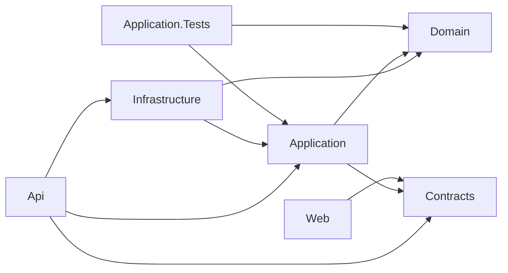
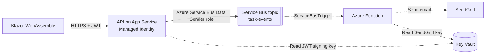

# TaskTracker

## 1. Overview

TaskTracker is a multi-tenant task tracker. A platform SuperAdmin creates organizations, organization Admins manage users, and any organization member can create a project. Each project has one owner, and only that owner assigns its members.

```text
Platform -> Organization -> Project -> Task
```

| Area | Technology |
|---|---|
| Runtime | .NET 10 (primary) and .NET 8, multi-targeted |
| API | ASP.NET Core Web API with controllers and Swagger |
| UI | Blazor WebAssembly (standalone) |
| Data | EF Core with SQL Server 2022 in Docker |
| Auth | ASP.NET Core Identity and JWT bearer tokens |
| Validation | FluentValidation |
| Notifications | Logging, database, or Azure Service Bus, selected by configuration |
| Tests | xUnit with SQLite in-memory and hand-written fakes |

## 2. Solution layout

| Project | References | Responsibility |
|---|---|---|
| `src/TaskTracker.Domain` | None | Entities, enums, and domain events. No NuGet packages. |
| `src/TaskTracker.Contracts` | None | DTOs and request records shared by the API and UI. |
| `src/TaskTracker.Application` | Domain, Contracts | Use cases, permissions, validation, and abstractions. |
| `src/TaskTracker.Infrastructure` | Application, Domain | EF Core, SQL Server, Identity, JWT, and Azure. |
| `src/TaskTracker.Api` | Application, Infrastructure, Contracts | HTTP endpoints and the composition root. |
| `src/TaskTracker.Web` | Contracts | Blazor WebAssembly UI. |
| `tests/TaskTracker.Application.Tests` | Application, Domain | Application-layer tests. |



Why each split exists:

- **Domain has no dependencies**, so business concepts cannot depend on a framework or database.
- **Contracts is shared with Web**, so the browser app never sees EF Core, entities, or server logic. Its enums intentionally duplicate the Domain enums, and Application maps between them.
- **Application defines what the system needs** through interfaces such as `IUserDirectory` and `INotificationPublisher`.
- **Infrastructure is the only project that knows SQL, Identity, or Azure.**
- **Api is the composition root.** Controllers translate HTTP to Application calls and never touch `DbContext`.

## 3. Running locally

### Prerequisites

- [.NET SDK 10.0.401 or later](https://dotnet.microsoft.com/download). Install the .NET 8 runtime too if you want to run the `net8.0` target.
- [Docker Desktop](https://www.docker.com/products/docker-desktop/)
- EF Core tools: `dotnet tool install --global dotnet-ef`

### Setup

**1. Create `.env` and set a strong SQL Server password.** Use 8 or more characters with uppercase, lowercase, a digit, and a symbol. Avoid `;` because the password goes into a connection string.

```powershell
Copy-Item .env.example .env
```

**2. Start SQL Server.** It listens on `127.0.0.1:14333`, so it will not conflict with a local SQL Server on 1433. Wait until the status is `healthy`.

```powershell
docker compose up -d
docker compose ps
```

**3. Store the connection string and JWT key in user secrets.**

PowerShell:

```powershell
$pw = ((Get-Content .env | Where-Object { $_ -like 'MSSQL_SA_PASSWORD=*' }) -split '=', 2)[1]
dotnet user-secrets set "ConnectionStrings:Default" "Server=127.0.0.1,14333;Database=TaskTracker;User Id=sa;Password=$pw;Encrypt=True;TrustServerCertificate=True" --project src/TaskTracker.Api
$bytes = New-Object byte[] 48; [Security.Cryptography.RandomNumberGenerator]::Create().GetBytes($bytes)
dotnet user-secrets set "Jwt:SigningKey" ([Convert]::ToBase64String($bytes)) --project src/TaskTracker.Api
```

Bash:

```bash
PASSWORD=$(grep '^MSSQL_SA_PASSWORD=' .env | cut -d= -f2- | tr -d '\r')
dotnet user-secrets set "ConnectionStrings:Default" "Server=127.0.0.1,14333;Database=TaskTracker;User Id=sa;Password=$PASSWORD;Encrypt=True;TrustServerCertificate=True" --project src/TaskTracker.Api
dotnet user-secrets set "Jwt:SigningKey" "$(openssl rand -base64 48)" --project src/TaskTracker.Api
```

**4. Restore packages and apply the migrations.** The API also applies migrations when it starts in Development.

```powershell
dotnet restore
dotnet ef database update -p src/TaskTracker.Infrastructure -s src/TaskTracker.Api --framework net10.0
```

**5. Run the API and Web app in two terminals.** Because the projects are multi-targeted, `-f` is required.

```powershell
dotnet run --project src/TaskTracker.Api -f net10.0
```

```powershell
dotnet run --project src/TaskTracker.Web -f net10.0
```

| App | URL |
|---|---|
| Web | http://localhost:5207 |
| API | http://localhost:5182 |
| Swagger | http://localhost:5182/swagger |

To run both from Visual Studio, right-click the solution, choose **Configure Startup Projects**, and select **Multiple startup projects** with `TaskTracker.Api` and `TaskTracker.Web`. To use .NET 8, replace `net10.0` with `net8.0`.

[`TaskTracker.Api.http`](src/TaskTracker.Api/TaskTracker.Api.http) contains ready-made requests.

**6. Run the tests.**

```powershell
dotnet test tests/TaskTracker.Application.Tests
```

## 4. Authentication and authorization

### Test accounts

These are created only in Development. Both use the password `Passw0rd!`.

| Email | Role | Starts in |
|---|---|---|
| `superadmin@tasktracker.local` | SuperAdmin | Organizations page |
| `admin@tasktracker.local` | Admin of Default Organization and owner of the seeded projects | Projects page |

### JWT flow

1. `POST /api/auth/login` validates the credentials through Identity and returns a signed JWT that lasts 60 minutes.
2. The token carries the user id, email, organization, organization role, and a hash of the Identity security stamp.
3. Every authenticated request re-checks that stamp and the user's and organization's active status. Role changes, password changes, and deactivation therefore revoke existing tokens immediately.
4. The Blazor `TokenStore` keeps the token and expiry in `localStorage`, so a refresh keeps the session.
5. `AuthHeaderHandler` attaches the bearer token to API calls. On a 401 it signs the user out and redirects to `/login`.

### Who can do what

Every endpoint except login requires a token.

Organization-level actions:

| Action | SuperAdmin | Org Admin | Org Member |
|---|---|---|---|
| Create or deactivate organizations, add their Admins | Yes | No | No |
| Manage users in own organization | No | Yes | No |
| Create a project and become its owner | No | Yes | Yes |
| Create a project for another owner | No | Yes | No |
| See every project in the organization | No | Yes | No |

Project-level actions:

| Action | SuperAdmin | Org Admin | Project owner | Contributor | Viewer |
|---|---|---|---|---|---|
| Delete the project | No | Yes | No | No | No |
| Edit project details | No | Yes | Yes | No | No |
| Transfer project ownership | No | Yes | Yes | No | No |
| **Assign project members** | No | No | **Only the owner** | No | No |
| Create, edit, delete, or change status of tasks | No | No | Yes | Yes | No |
| View the project and its tasks | No | Yes | Yes | Yes | Yes |

Organization members who are not on a project cannot see it.

### Tenant isolation

- The organization always comes from the signed-in user, never from the request.
- EF Core query filters scope projects, tasks, and memberships to that organization. With no organization, they match no rows.
- Composite foreign keys make the database reject an owner or member from another organization.
- Another organization's data returns 404, so its ids cannot be probed.

### Safeguards

- The last active Admin of an organization cannot be demoted or deactivated.
- Admins cannot change their own role or status.
- A project owner can only be deactivated by choosing a new owner. The transfer and deactivation happen in one transaction.
- Deactivating an organization signs out all of its users.
- Status, role, and priority fields are required, so an empty request body cannot demote or deactivate anything.
- Two requests changing the same row return 409 rather than a server error.

## 5. External integration

### Notification abstraction

`TaskService.UpdateStatusAsync` publishes a `TaskStatusChangedEvent` through `INotificationPublisher`.

- It publishes **after** the status change is saved, and only if the status actually changed.
- A publisher failure is caught and logged, and the request still succeeds.
- `CompositeNotificationPublisher` sends to every configured provider, so one failing provider does not stop the others.
- A crash between the save and the publish can lose an event. The **outbox pattern** is the next step: write the event in the same transaction and publish it from a background worker.

### Local and production providers

Providers are chosen entirely through `Notifications:Providers`. An unknown name stops the app at startup.

| Environment | Providers | Result |
|---|---|---|
| Development | `Logging`, `Database` | Structured log line and a `NotificationLog` row |
| Production | `ServiceBus` | JSON message on the `task-events` topic |

### Production architecture

Solid arrows are implemented in this repository. **Dashed arrows are the proposed deployment and are not built here**, including the Azure Function and SendGrid email.



- The API authenticates to Service Bus with `DefaultAzureCredential` and the **Azure Service Bus Data Sender** RBAC role, so there is no connection string.
- Key Vault holds the JWT signing key and SendGrid key.
- The Service Bus publisher compiles and is registered through configuration, but it has **not been run against a real Azure namespace**.

### Production configuration

No secrets belong in this file:

```json
{
  "KeyVault": {
    "Uri": "https://your-vault.vault.azure.net/"
  },
  "WebOrigin": "https://your-web-app.example.com",
  "Notifications": {
    "Providers": [ "ServiceBus" ],
    "ServiceBus": {
      "FullyQualifiedNamespace": "your-namespace.servicebus.windows.net",
      "TopicName": "task-events"
    }
  }
}
```

| Key Vault secret | Configuration key |
|---|---|
| `Jwt--SigningKey` | `Jwt:SigningKey` |
| `ConnectionStrings--Default` | `ConnectionStrings:Default` |
| `Bootstrap--SuperAdminEmail` | `Bootstrap:SuperAdminEmail` |
| `Bootstrap--SuperAdminPassword` | `Bootstrap:SuperAdminPassword` |

The bootstrap values create the first SuperAdmin only if none exists. Outside Development, migrations do not run at startup and must be a deployment step.

### Key Vault setup

This is not wired in yet. Add the `Azure.Extensions.AspNetCore.Configuration.Secrets` package to the API, then add this to `Program.cs` before `AddInfrastructure`:

```csharp
using Azure.Identity;

var builder = WebApplication.CreateBuilder(args);

if (builder.Configuration["KeyVault:Uri"] is { Length: > 0 } keyVaultUri)
{
    builder.Configuration.AddAzureKeyVault(new Uri(keyVaultUri), new DefaultAzureCredential());
}
```

## 6. Completed and deferred

### Completed

- [x] Clean project separation with an enforced reference graph
- [x] EF Core migrations and seed data
- [x] REST API with DTOs, validation, ProblemDetails errors, and Swagger
- [x] JWT authentication with immediate token revocation
- [x] Organizations, SuperAdmin, organization roles, project owners, and project members
- [x] Tenant isolation in queries and database constraints
- [x] Blazor UI for login, organizations, users, projects, members, tasks, and password change
- [x] Pluggable notifications with failure isolation
- [x] Application-layer tests on .NET 10 and .NET 8

### Deferred

- [ ] Outbox pattern for guaranteed notification delivery
- [ ] Azure Function, SendGrid email, and Key Vault wiring
- [ ] Automated integration tests for real EF filters, Identity, and API policies
- [ ] CI pipeline
- [ ] Refresh tokens, and HttpOnly cookies instead of `localStorage`
- [ ] Login rate limiting and lockout
- [ ] Email invitations and forced change of temporary passwords
- [ ] Assigning individual tasks to people
- [ ] Pagination
- [ ] Users in multiple organizations, organization rename, and a SuperAdmin management screen

## 7. Design decisions and trade-offs

- **`IAppDbContext` instead of repositories.** EF Core already provides the unit of work and querying. The trade-off is a small EF dependency in Application.
- **`Result<T>` for expected outcomes.** Not found, validation, and permission failures are normal flow, so exceptions stay for real failures.
- **Duplicated enums in Contracts.** A little repetition keeps the public API independent of the domain model.
- **Authentication required on all reads.** Public GET endpoints would expose data across organizations.
- **Global query filters for tenancy.** A service cannot forget the organization check. Bypassing a filter is limited to Infrastructure.
- **404 across organizations, 403 within one.** Users learn nothing about other tenants but get a clear answer for resources they can see.
- **A database check on every authenticated request.** One small query buys immediate revocation, at some cost to pure JWT statelessness.
- **Org Admins can transfer ownership but cannot assign members.** This keeps assignment owner-only while ensuring a project is never stranded when its owner leaves.
- **One organization per user.** This is enforced by a unique index on the membership table, so it can be relaxed later without redesigning the model.
- **`localStorage` for the token.** It is simple and survives refreshes, but script injected through XSS could read it. Short token lifetime limits the exposure.
- **Multi-targeting .NET 10 and .NET 8.** .NET 8 reached end of support in November 2026, so .NET 10 is primary and .NET 8 is kept for compatibility. Swashbuckle stays on 10.x because 11.x dropped .NET 8.
